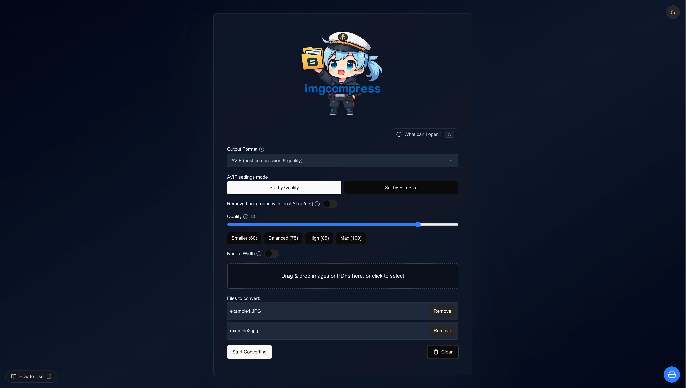

<div align="center">
  
  <h1>ImgCompress</h1>
  <p><strong>Every image format. Zero cloud.</strong></p>
  <p>Make images smaller, convert 70+ formats, edit them, upscale with AI and remove backgrounds.<br/>Everything runs in your container — files never leave your server.</p>

  <p>
    <a href="https://imgcompress.karimzouine.com/">
      
    </a>
    <a href="https://imgcompress.karimzouine.com/docs/installation">
      
    </a>
  </p>

  <p>
    <a href="https://hub.docker.com/r/karimz1/imgcompress">
      
    </a>
    <a href="https://github.com/karimz1/imgcompress">
      
    </a>
    <a href="https://github.com/sponsors/karimz1">
      
    </a>
    <a href="./TRANSLATIONS.md">
      
    </a>
  </p>

  <p>
    <a href="https://imgcompress.karimzouine.com/">Website</a> ·
    <a href="https://imgcompress.karimzouine.com/docs">Docs</a> ·
    <a href="https://imgcompress.karimzouine.com/docs/installation">Installation</a> ·
    <a href="https://hub.docker.com/r/karimz1/imgcompress">Docker Hub</a> ·
    <a href="https://github.com/karimz1/imgcompress/issues">Issues</a>
  </p>

  <br />

  

  <br /><br />

  <p><strong>Featured & Listed On</strong></p>

  <p>
    <a href="https://github.com/awesome-selfhosted/awesome-selfhosted#readme">
      
    </a>
    <a href="https://coolify.io/docs/services/imgcompress?utm_source=github.com">
      
    </a>
    <a href="https://selfhostedworld.com/software/imgcompress">
      
    </a>
    <a href="https://selfh.st/apps/?search=imgcompress">
      
    </a>
    <a href="https://alternativeto.net/software/imgcompress/about">
      
    </a>
    <a href="https://www.pitchhut.com/project/imgcompress-toolbox">
      
    </a>
  </p>
</div>

---

## Features

- **70+ formats** — HEIC, PSD, SVG, AVIF, PDF, WebP and more
- **Compress & convert** — bulk jobs in the web UI or CLI
- **Image editor** — crop, exact sizes, backgrounds, text and logos ([guide](https://imgcompress.karimzouine.com/docs/image-editor))
- **AI upscaling** — sharper enlargements up to 16K, on your CPU ([guide](https://imgcompress.karimzouine.com/docs/ai-upscaling))
- **Background removal** — local AI, no account
- **One container** — works offline after the first pull
- **12 languages**

What's new in v1.0: [release notes](https://imgcompress.karimzouine.com/docs/release-notes).

---

## Quick Start

You need [Docker](https://docs.docker.com/get-started/get-docker/). Run once, then open `http://localhost:3001`:

```bash
docker run -d \
  --name imgcompress \
  -p 3001:5000 \
  karimz1/imgcompress:latest
```

Compose examples in [`docker/compose/`](docker/compose/):

- **[advanced.docker-compose.yaml](docker/compose/advanced.docker-compose.yaml)** — home / LAN
- **[proxied.docker-compose.yaml](docker/compose/proxied.docker-compose.yaml)** — HTTPS with Traefik
- **[ntfy.docker-compose.yaml](docker/compose/ntfy.docker-compose.yaml)** — phone notifications
- **[compose guide](docker/compose/README.md)** — step by step

Settings (upload limit, workers, notify, update check): [Installation](https://imgcompress.karimzouine.com/docs/installation) · [Configuration](https://imgcompress.karimzouine.com/docs/configuration)

---

## Docs

- [Installation](https://imgcompress.karimzouine.com/docs/installation)
- [Configuration](https://imgcompress.karimzouine.com/docs/configuration)
- [Notifications](https://imgcompress.karimzouine.com/docs/notifications)
- [AI upscaling](https://imgcompress.karimzouine.com/docs/ai-upscaling)
- [Image editor](https://imgcompress.karimzouine.com/docs/image-editor)
- [CLI](https://imgcompress.karimzouine.com/docs/cli)
- [FAQ](https://imgcompress.karimzouine.com/docs/faq)
- Full index: [imgcompress.karimzouine.com/docs](https://imgcompress.karimzouine.com/docs)

---

## Privacy

Files stay in your container. No cloud APIs. Optional notify messages never include file names. Details: [Privacy](https://imgcompress.karimzouine.com/docs/privacy).

---

## Contributing

Bug reports and PRs welcome. See [contributing.md](contributing.md) and the [Developer Guide](https://imgcompress.karimzouine.com/docs/developers). Architecture notes live in [docs/architecture.md](docs/architecture.md).

---

## Support the Project

<p align="center">
  <a href="https://github.com/sponsors/karimz1">
    
  </a>
  <a href="https://buymeacoffee.com/karimz1">
    
  </a>
  <a href="https://www.paypal.com/paypalme/KarimZouine972">
    
  </a>
</p>

---

## License & Author

**Author**: [Karim Zouine](https://www.karimzouine.com)  
**License**: [GPL-3.0](LICENSE)  
**Docker Image**: [hub.docker.com/r/karimz1/imgcompress](https://hub.docker.com/r/karimz1/imgcompress)
