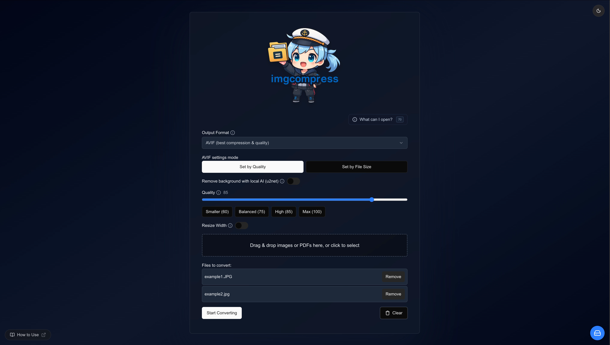
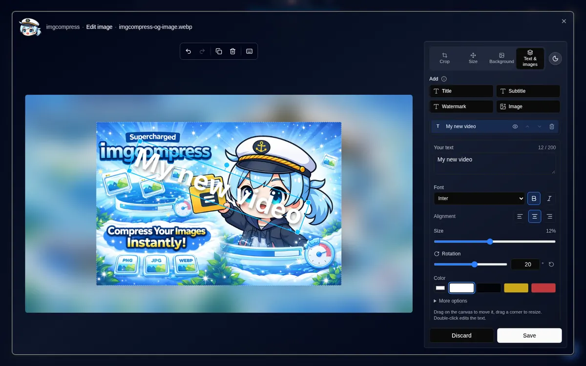
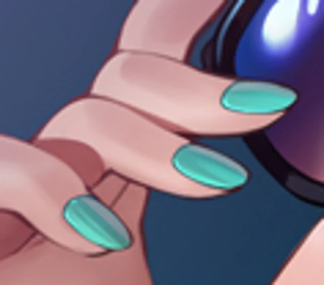
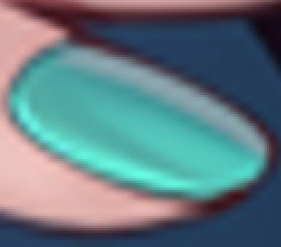
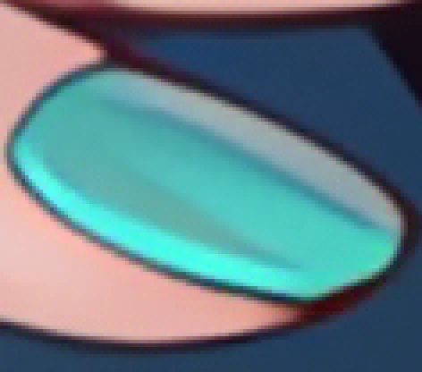

<div align="center">
  
  <h1>ImgCompress</h1>
  <p><strong>Every image format. Zero cloud.</strong></p>
  <p>Make images smaller, convert 70+ formats, edit them, make them bigger with AI and remove backgrounds. In 12 languages.<br/>Everything runs inside your container, so your files never leave your server.</p>

  <p>
    <a href="https://imgcompress.karimzouine.com/">
      
    </a>
    <a href="https://imgcompress.karimzouine.com/docs/installation">
      
    </a>
  </p>

  <p>
    <a href="https://hub.docker.com/r/karimz1/imgcompress">
      
    </a>
    <a href="https://github.com/karimz1/imgcompress">
      
    </a>
    <a href="https://github.com/sponsors/karimz1">
      
    </a>
    <a href="./TRANSLATIONS.md">
      
    </a>
  </p>

  <p>
    <a href="https://imgcompress.karimzouine.com/">Website</a> ·
    <a href="https://imgcompress.karimzouine.com/docs">Docs</a> ·
    <a href="https://imgcompress.karimzouine.com/docs/installation">Installation Guide</a> ·
    <a href="https://hub.docker.com/r/karimz1/imgcompress">Docker Hub</a> ·
    <a href="https://github.com/karimz1/imgcompress/issues">Issues</a>
  </p>

  <br />

  

  <br /><br />

  <p><strong>Featured & Listed On</strong></p>

  <p>
    <a href="https://github.com/awesome-selfhosted/awesome-selfhosted#readme">
      
    </a>
    <a href="https://coolify.io/docs/services/imgcompress?utm_source=github.com">
      
    </a>
    <a href="https://selfhostedworld.com/software/imgcompress">
      
    </a>
    <a href="https://selfh.st/apps/?search=imgcompress">
      
    </a>
    <a href="https://alternativeto.net/software/imgcompress/about">
      
    </a>
    <a href="https://www.pitchhut.com/project/imgcompress-toolbox">
      
    </a>
  </p>
</div>

---

## What is ImgCompress?

ImgCompress is a **self-hosted image app in a single Docker container**, easy for everyone with no IT knowledge needed: set it up once on your own server, NAS or PC, then do everything in a modern web page, with no command line. It makes images smaller, converts **70+ formats** (HEIC, PSD, SVG, PDF and more), lets you **edit** them (crop, exact sizes, text, logos, thumbnails), makes small images **bigger and sharper with AI** up to 16K, and **removes backgrounds**. The AI is already built in, and everything runs locally inside your container on your own hardware: private, no cloud APIs, works offline, free and open source.

---

## Features

| Feature | Details |
|---|---|
| **70+ Image Formats** | HEIC, HEIF, PSD, SVG, AVIF, EPS, PDF, WebP, TIFF, BMP, GIF, and 60 more ([which are tested](https://imgcompress.karimzouine.com/#formats)) |
| **AI Background Removal** | Built in and ready to use. No account, no subscription, no upload |
| **AI Upscaling** | Make small images bigger and sharper, up to 16K, offline ([guide](https://imgcompress.karimzouine.com/docs/ai-upscaling)) |
| **Image Editor** | Crop, exact sizes, backgrounds, text and logos before converting ([guide](https://imgcompress.karimzouine.com/docs/image-editor)) |
| **Bulk Compression** | Make a whole folder of photos smaller in one go |
| **Format Conversion** | HEIC to WebP, PSD to JPG, [SVG to PNG](https://imgcompress.karimzouine.com/docs/svg-to-png), image batches to paginated PDF, and more ([WebP guide](https://imgcompress.karimzouine.com/docs/convert-to-webp)) |
| **Web App + CLI** | An easy web page for everyday use, plus a command line for automation |
| **One Container** | Everything is included. Nothing else to install |
| **Works Offline** | After the first download, no internet is needed, ever |

**What's new in v1.0:** the image editor, AI upscaling, SVG import, WebP export and more. See the **[release notes](https://imgcompress.karimzouine.com/docs/release-notes)**.

---

## Image editor

Edit images right in the browser before you convert them. Everything is rendered on your own server.



- **[Crop, resize and rotate](https://imgcompress.karimzouine.com/docs/image-editor):** pick an exact size, add a background, a logo or other pictures, and turn anything. Undo, keyboard shortcuts and touch on tablets included.
- **[YouTube thumbnails and social media sizes](https://imgcompress.karimzouine.com/docs/youtube-thumbnail):** presets for YouTube, Shorts and stories, Instagram, X, link previews, GitHub, Pinterest, Full HD, 2K and 4K.
- **[Add text to an image](https://imgcompress.karimzouine.com/docs/add-text-to-image):** titles, subtitles and watermarks with a choice of fonts, color, shadow and angle.
- **[Smart crop](https://imgcompress.karimzouine.com/docs/smart-crop):** resize to an exact size and keep the important part in frame, or keep the whole image on a blurred background.

---

## AI image upscaling

Make small photos and drawings bigger and sharper, up to 16K. The AI is already built in: just switch it on. Pick **General** for photos or **Anime** for drawings, anime and logos. For General, pick the **Image type**: **Photo (keep details)** for sharp photos, **Balanced** for everyday images, or **Old or noisy photo (smooth)** (the default) for grainy ones. Same speed. It runs on your server's CPU, so no graphics card is needed, and nothing is uploaded. **[Guide](https://imgcompress.karimzouine.com/docs/ai-upscaling)**

**Original vs. AI upscaled (Anime):** the same spot at the same size. Left: the original, just enlarged. Right: AI upscaling (Anime), done by the AI built into ImgCompress, inside your own container. Nothing is uploaded, your images never leave your server.

| Original | AI upscaled (Anime) |
|:---:|:---:|
|  |  |
|  |  |

<sub>Original image: [Pixabay](https://pixabay.com/illustrations/ai-generated-girl-dystopia-ruins-9062885/), made bigger from 3100 to 8640 px.</sub>

**A tiny drawing (118 × 104 px) made 4x bigger.** Left: normal enlargement. Right: AI upscaling (Anime), done by the AI built into ImgCompress, inside your own container. Nothing is uploaded, your images never leave your server. The second row zooms in on one fingernail.

| Original | AI upscaled (Anime) |
|:---:|:---:|
|  |  |
|  |  |

---

## AI Background Removal: Local & Private

Remove the background from a photo in one click, without uploading it anywhere. The AI is already built in and runs **on your own hardware**, inside your container. No file ever leaves your server. Nothing to install, no account, no subscription.

| Original | Background Removed |
|:---:|:---:|
|  |  |

---

## Quick Start

Copy this command, run it once, then open `localhost:3001` in your browser. That's it, about 60 seconds. You only need [Docker](https://docs.docker.com/get-started/get-docker/).

```bash
docker run -d \
  --name imgcompress \
  -p 3001:5000 \
  karimz1/imgcompress:latest
```

Prefer Docker Compose? Ready-made configurations live in [`docker/compose/`](docker/compose/):

- **[advanced.docker-compose.yaml](docker/compose/advanced.docker-compose.yaml)** for use at home: open it from any device on your network. Safe defaults are already set.
- **[proxied.docker-compose.yaml](docker/compose/proxied.docker-compose.yaml)** for your own web address with HTTPS (uses Traefik and, if you like, free Let's Encrypt certificates).

Step-by-step instructions for both are in the **[compose guide](docker/compose/README.md)**.

Each upload can be up to 40 GB, so big PSD and PDF files work. To set a smaller limit, add `MAX_UPLOAD_SIZE_MB` (for example `-e MAX_UPLOAD_SIZE_MB=500`). If other people can reach your copy over the internet, a smaller limit like 1 GB (`1024`) is a good idea. More in the [upload limit guide](https://imgcompress.karimzouine.com/docs/installation#upload-limit).

**Notify me when done (optional):** set `NOTIFY_URL` to any [Apprise](https://github.com/caronc/apprise) URL, for example your own ntfy server (`NOTIFY_URL=ntfy://ntfy/imgcompress`). A switch then shows up while a conversion runs. Turn it on, close the tab, and you get one message when it is done. It says how many images are ready and to open imgcompress in the browser you used, for example "Open imgcompress in Safari on your iPhone to get your result." Never file names. Your result belongs to that browser, so the message does not open a link by itself. Optional: set `PUBLIC_BASE_URL` to the address you open imgcompress at, and it is added to the message. It is never taken from a request, because the Host header can be faked. A ready-made setup with ntfy is in **[ntfy.docker-compose.yaml](docker/compose/ntfy.docker-compose.yaml)**. On iOS the ntfy app fetches the message from your ntfy server, so away from home you need a VPN to your network.

For more settings, such as hiding the mascot, see the **[full installation guide](https://imgcompress.karimzouine.com/docs/installation)**.

---

## Why I Built ImgCompress

I was tired of the "software loop." Every time I needed something simple, I had to install another app:

- **PSD files**: Needed specialized software just to convert them to an image file.
- **HEIC files**: Needed another converter for regular photo files.
- **Image to PDF**: Needed another app just to share a screenshot for work, since a PDF is often better for emails and easy for others to print.
- **AI Backgrounds**: I realized I needed one more app for that too.

I thought to myself: "Why can't one tool just do it all?" Plus, uploading personal photos to random online converters never felt right to me.

### One Toolbox for Everything

So I built a single toolbox that can take over **70 different formats** and fix them all in one place. Whether you need to convert PSD or HEIC files to an image, turn a screenshot into a PDF for a work email, or shrink a massive 4K photo, this tool does it automatically.

The community has now pulled the image tens of thousands of times, which shows the pain is real.

### Why Docker?

I chose Docker because it keeps your computer clean. Instead of installing 70 different tools yourself, you get one **ready-to-go box** called **imgcompress** that runs anywhere. It just works.

---

## Privacy by Design

| | |
|---|---|
| **No cloud** | Converting, compressing and the AI all run locally inside your container. Your images never leave your server. |
| **No tracking** | No analytics and no data sent home. After it starts, it stays quiet on the network. |
| **Works offline** | After the first download, it never needs the internet again. No license checks, no expiry. |
| **Free and open source** | GPL-3.0. Anyone can read the code, and you can use it for free, forever. |

---

## Security-Hardened Docker Image

ImgCompress keeps only what it needs, so there is less that can go wrong. For the technically curious, here are the details:

| | |
|---|---|
| **Minimal Surface** | No shell (`bash`, `sh`), no network tools (`curl`, `wget`, etc.), no package manager. The attack surface is drastically reduced. |
| **Minimal Components** | System dependencies are aggressively pruned to maintain a minimal runtime environment. |
| **Non-root User** | Runs as a non-root user `nonroot` by default. |
| **DHI Base Images** | Using Docker Hardened Images from the official [DHI](https://www.docker.com/products/hardened-images/) project for build phases and runtime Image. |
| **SBOM and Provenance** | The Docker Image is built with a full Software Bill of Materials (SBOM) and build provenance attestation. |

<div align="right">
  <a href="https://github.com/AlexanderSlokov">
    
  </a>
</div>

---

## Multilingual Support

ImgCompress supports multiple frontend languages and welcomes community improvements to every locale. See the **[translation guide](TRANSLATIONS.md)** to add a new language, improve an existing translation, or get credited for meaningful language updates.

Supported languages:

- English
- Spanish
- Spanish (Mexico)
- Chinese (Simplified)
- Hindi
- Arabic
- French
- Portuguese (Brazil)
- Russian
- Japanese
- German
- Hungarian

<div align="right">
  <a href="https://github.com/karimz1/imgcompress/issues/653">
    
  </a>
</div>

---

## Featured & Listed On

ImgCompress is recognized across the self-hosted community and featured on curated lists and deployment platforms:

- **[Awesome Self-Hosted](https://github.com/awesome-selfhosted/awesome-selfhosted#readme)** [](https://github.com/awesome-selfhosted/awesome-selfhosted): Community-curated index of self-hosted software.
- **[Coolify](https://github.com/coollabsio/coolify)** [](https://github.com/coollabsio/coolify): Open-source PaaS — available as an **official Coolify service**.
- **[SelfHostedWorld](https://selfhostedworld.com/software/imgcompress)** & **[selfh.st](https://selfh.st/apps/?search=imgcompress)**: Featured directories and registries for self-hosting enthusiasts.
- **[xCloud](https://xcloud.host/imgcompress-hosting/)**: Offers one-click deployment of ImgCompress on a cloud server. **ImgCompress itself is free** — you only pay for the cloud server provided by xCloud. (I'm not affiliated with xCloud.)
- **[AlternativeTo](https://alternativeto.net/software/imgcompress/about)** & **[PitchHut](https://www.pitchhut.com/project/imgcompress-toolbox)**: Listed as a privacy-respecting local image processing alternative.

> **A note from the creator:**  
> A huge thank you to everyone who has supported ImgCompress and helped it reach more people! Seeing so many people embrace privacy-focused tools and use ImgCompress in their everyday workflows makes all the time and effort worthwhile. Thank you for being part of this journey! ❤️  
> — **[Karim Zouine](https://www.karimzouine.com)**, Creator of ImgCompress

> Know another platform featuring ImgCompress, or want to add it? [Get in touch](https://www.karimzouine.com/#contact).

---

## Documentation

- [Installation & Configuration](https://imgcompress.karimzouine.com/docs/installation): Docker setup, environment variables, reverse proxy examples
- [Developer Guide](https://imgcompress.karimzouine.com/docs/developers): VS Code Dev Containers, architecture overview, local env setup
- [imgcompress-chan (Bot)](https://imgcompress.karimzouine.com/docs/imgcompress-chan): Custom helper bot that repairs Dependabot pnpm lockfiles and auto-merges dependency PRs
- [E2E Testing with Playwright](https://imgcompress.karimzouine.com/docs/e2e): How the app is tested end to end, offline
- [Credits & Libraries](https://imgcompress.karimzouine.com/docs/credits): The open source projects that power ImgCompress
- [Hall of Fame](https://imgcompress.karimzouine.com/docs/hall-of-fame): Sponsors and contributors

---

## Contributing

Contributions are welcome: bug reports, format requests, or pull requests.

> [!TIP]
> **New contributor?** The project ships a **VS Code Dev Container** with all 70+ image libraries and the AI environment pre-configured. Working local setup in under a minute. See the [Developer Guide](https://imgcompress.karimzouine.com/docs/developers).

- Read the **[Contributing Guide](contributing.md)** before opening a PR
- See the **[Architecture overview](docs/architecture.md)** for how jobs, storage and cleanup fit together
- Browse [`good-first-issue`](https://github.com/karimz1/imgcompress/labels/good-first-issue) labels for a starting point
- Every change runs a Playwright E2E suite; 49 of the 71 input formats pass automated conversion tests
- Maintainers: [release workflow](https://imgcompress.karimzouine.com/docs/release-workflow), [build details](https://imgcompress.karimzouine.com/docs/build-details) and [CI feature flags](https://imgcompress.karimzouine.com/docs/ci-feature-flags)

> [!NOTE]
> **Meet [imgcompress-chan](https://imgcompress.karimzouine.com/docs/imgcompress-chan)**, the repo's custom helper bot. She auto-merges Dependabot PRs once CI passes, and if a frontend dependency update leaves a broken `pnpm-lock.yaml`.

---

## Support the Project

ImgCompress is an independent open-source project built and maintained in my free time. If ImgCompress saves you time or server resources, consider supporting its continued development:

<p align="center">
  <a href="https://github.com/sponsors/karimz1">
    
  </a>
  <a href="https://buymeacoffee.com/karimz1">
    
  </a>
  <a href="https://www.paypal.com/paypalme/KarimZouine972">
    
  </a>
</p>

*Donations are completely optional — starring the repo, sharing it, and contributing are already greatly appreciated!*

---

## License & Author

**Author**: [Karim Zouine](https://www.karimzouine.com)  
**License**: [GPL-3.0](LICENSE)  
**Docker Image**: [hub.docker.com/r/karimz1/imgcompress](https://hub.docker.com/r/karimz1/imgcompress)

If ImgCompress saves you time, a GitHub star helps others discover it.
