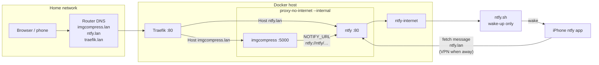

# Homelab example: Traefik + ImgCompress + ntfy

This is just an example. I run this in my home lab; it's not perfect but it works for me. On my other setups I use HTTPS, but here I want to show a simple setup most self-hosters understand. It should help you get started.

**A great starting point for self-hosters:** three small compose files, `.lan` names, Traefik on port 80, ImgCompress with no Internet, and your own ntfy (with ntfy.sh only waking the iPhone app).

## How it fits together



- **proxy-no-internet** is created with `--internal`, so ImgCompress has no outbound Internet.
- **ntfy** also joins **ntfy-internet** so it can reach `ntfy.sh` for iOS wake-ups. The wake-up carries no message text; the app then fetches the real message from `http://ntfy.lan`.
- On a LAN-only ntfy, a **long random topic** is enough (no password). Change `NTFY_TOPIC` in `.env` before you go live.

## Files

| File | Role |
| :--- | :--- |
| `traefik.docker-compose.yaml` | Reverse proxy on port 80, dashboard at `traefik.lan` |
| `ntfy.docker-compose.yaml` | Your ntfy server at `ntfy.lan` |
| `imgcompress.docker-compose.yaml` | ImgCompress at `imgcompress.lan` |
| `.env.example` | Image tag, TZ, topic — copy to `.env` |

## Steps

1. **Copy settings**
   ```bash
   cd docker/compose/homelab-traefik-ntfy
   cp .env.example .env
   # edit NTFY_TOPIC (and TZ / image tag if you like)
   ```

2. **Create the shared networks** (once)
   ```bash
   docker network create proxy
   docker network create proxy-no-internet --internal
   ```
   `ntfy-internet` is created by the ntfy compose file.

3. **Start Traefik**
   ```bash
   docker compose -f traefik.docker-compose.yaml up -d
   ```

4. **Start ntfy**
   ```bash
   mkdir -p ntfy/cache
   docker compose -f ntfy.docker-compose.yaml up -d
   ```

5. **Start ImgCompress**
   ```bash
   docker compose -f imgcompress.docker-compose.yaml up -d
   ```

6. **Router DNS** — create `imgcompress.lan`, `ntfy.lan` and `traefik.lan` in your router's DNS settings, pointing at the Docker host.

7. **Open** [http://imgcompress.lan](http://imgcompress.lan). While a job runs, turn on **Notify me when done**.

8. **Subscribe in the ntfy app** to the same topic as `NTFY_TOPIC` on server `http://ntfy.lan`. Away from home, use a VPN to your network (the app fetches the message from your ntfy; ntfy.sh only wakes the phone).

## Check the files

```bash
docker compose -f traefik.docker-compose.yaml config >/dev/null
docker compose -f ntfy.docker-compose.yaml --env-file .env config >/dev/null
docker compose -f imgcompress.docker-compose.yaml --env-file .env config >/dev/null
```

## Notes

- Homepage dashboard labels are commented out (`# Optional: Homepage dashboard`). Uncomment them if you use [Homepage](https://gethomepage.dev/).
- For HTTPS / Let's Encrypt, start from [`proxied.docker-compose.yaml`](../proxied.docker-compose.yaml) instead; this example stays on plain HTTP so the path is easy to follow.
- Full notification guide: [Notify me when done](https://imgcompress.karimzouine.com/docs/notifications).
