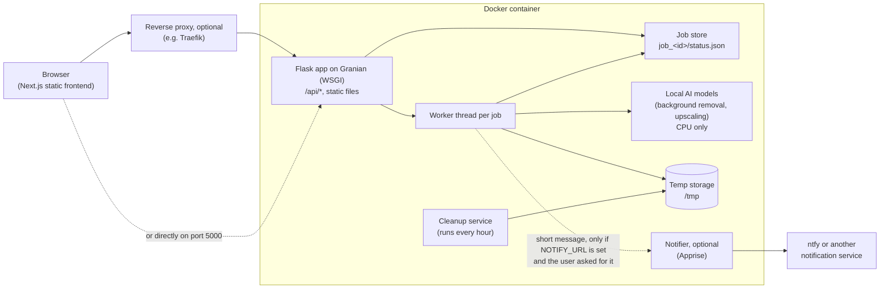
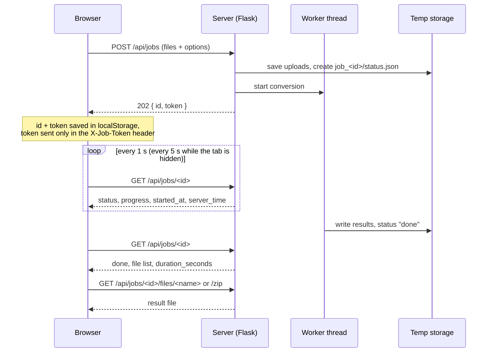

# Architecture

How imgcompress is put together, and how a conversion travels from the browser to the result. Everything below runs inside your container. Your files never leave your server.

## Overview

- **Frontend:** a static Next.js export. Flask serves it, so there is no Node server in the container.
- **Backend:** Flask on [Granian](https://github.com/emmett-framework/granian) with several worker processes. Any worker can answer a status poll, because the job state lives in a file in the temp folder, not in one process's memory.
- **AI models:** shipped inside the image and run on the CPU. Nothing is downloaded at run time and no image is sent anywhere.
- **Notifier:** off by default. When enabled, only a short text such as "3 images ready" goes out, never file names or images.

## A background job

- **Leaving and coming back:** the job keeps running on the server when the phone switches apps, the tab is closed or the page reloads. On `visibilitychange`, `pageshow` and `focus` the page drops any request that may be frozen and asks again right away. Each status request gives up after 15 seconds and is retried.
- **Reload:** the page reads the job id and token from `localStorage` and picks the job up again, running or finished. It forgets the job when you clear the result, start a new conversion or the server answers 404.
- **Privacy on a shared server:** each job has its own secret token. The server keeps only its SHA-256. A wrong token, a missing token and an unknown id all get the same 404.
- **Retention:** finished results are kept for at least 24 hours. The cleanup service runs every hour and deletes temp folders with no activity for 48 hours (`temporary_storage.max_age_seconds` in `backend/image_converter/config/app.json`). Every poll or download counts as activity. Folders of running jobs are locked and never deleted.

## Why polling and not WebSockets

The browser starts a job, gets `202 Accepted` with an id, and asks for the status until it is done. This is the [Asynchronous Request-Reply pattern](https://learn.microsoft.com/azure/architecture/patterns/async-request-reply) from the Azure Architecture Center.

- **iPhones:** iOS Safari closes open connections when you switch apps or lock the phone. A WebSocket would be gone, and the result with it. A poll simply runs again when the page comes back.
- **WSGI server:** Granian runs the app as WSGI, where each request is short. Long-lived sockets would need a different server setup.
- **Any proxy:** plain HTTP requests work behind Traefik, nginx, Caddy or Cloudflare without extra WebSocket settings or timeouts.
- **Later:** Server-Sent Events could make progress updates faster without changing the job model. For people who leave the page entirely, the optional ntfy notification tells them when the result is ready.

## Where to look in the code

| Part | File |
| --- | --- |
| HTTP routes | `backend/image_converter/presentation/web/routes.py` |
| Starting and following jobs | `backend/image_converter/presentation/web/services/conversion_job_service.py` |
| Job state on disk | `backend/image_converter/infrastructure/conversion_job_store.py` |
| Cleanup | `backend/image_converter/infrastructure/cleanup_service.py` |
| Polling in the browser | `frontend/src/lib/conversionJob.ts` |
| Settings | `backend/image_converter/config/app.json` |
