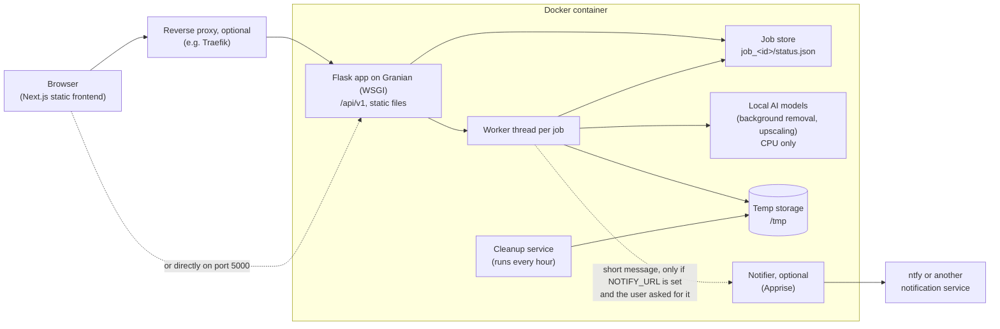
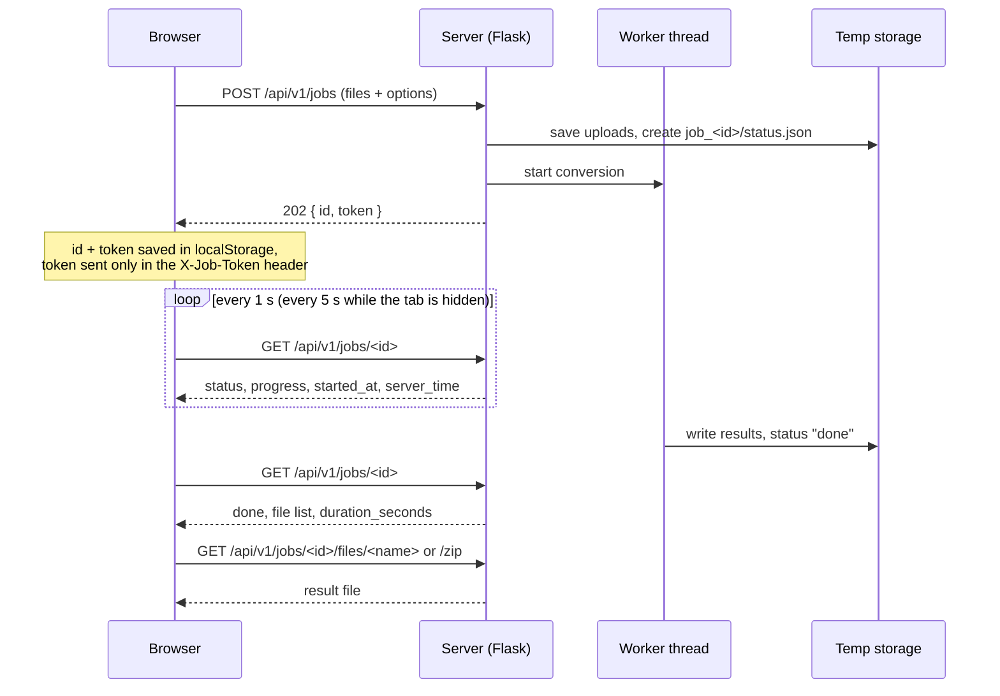
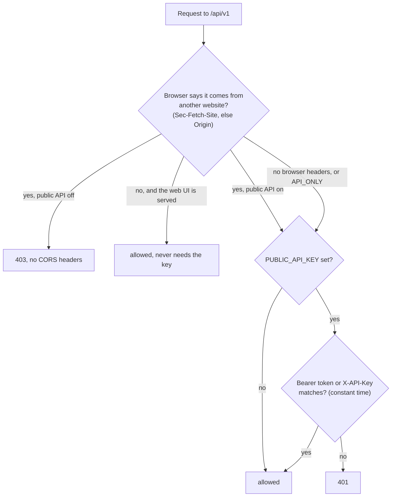

# Architecture

How imgcompress is put together, and how a conversion travels from the browser to the result. Everything below runs inside your container. Your files never leave your server.

## Overview

- **Frontend:** a static Next.js export. Flask serves it, so there is no Node server in the container.
- **Backend:** Flask on [Granian](https://github.com/emmett-framework/granian) with several worker processes. Any worker can answer a status poll, because the job state lives in a file in the temp folder, not in one process's memory.
- **AI models:** shipped inside the image and run on the CPU. Nothing is downloaded at run time and no image is sent anywhere.
- **Notifier:** off by default. When enabled, only a short text such as "3 images ready" goes out, never file names or images. The switch on the wait screen calls `POST /api/v1/jobs/<id>/notify` with the job token. The choice is a small `notify` file in the job folder, so any worker can save it while another one runs the job. After the job ends, that worker sends one message through Apprise (`NOTIFY_URL`). A failed send is only logged, without the URL.
- **Share link:** with `PUBLIC_BASE_URL` set, the message links to `<PUBLIC_BASE_URL>/r/<job id>/<share token>`. The share token is a fresh `secrets.token_urlsafe(32)` made when the message is sent; only its SHA-256 is kept (a `share` file in the job folder), and it is never the job token. Opening the link loads the page, which removes the secret from the address bar and calls `POST /api/v1/jobs/<id>/claim` with the share token in the body. That gives the browser a job token of its own (its hash is appended to a `devices` file, with no cap), and from there it polls and downloads with `X-Job-Token` like the browser that started the job. A wrong or expired link gets the same 404 as any unknown job. The link lives as long as the job (48 hours after the last look by default). The message also stamps an expiry in the container's local timezone (set with `TZ`, e.g. `Europe/Berlin`) from send time plus `temporary_storage.max_age_seconds` (48 hours by default); later activity can keep the job longer on the server. Whoever can read the notification can open the result, so the ntfy topic should stay private.

## A background job

- **Leaving and coming back:** the job keeps running on the server when the phone switches apps, the tab is closed or the page reloads. On `visibilitychange`, `pageshow` and `focus` the page drops any request that may be frozen and asks again right away. Each status request gives up after 15 seconds and is retried.
- **Reload:** the page reads the job id and token from `localStorage` and picks the job up again, running or finished. It forgets the job when you clear the result, start a new conversion or the server answers 404.
- **Privacy on a shared server:** each job has its own secret token. The server keeps only its SHA-256. A wrong token, a missing token and an unknown id all get the same 404.
- **Folders:** when a whole folder is dropped and "Keep folder structure" is on (off by default, remembered in the browser), the browser sends the folder of each file (`relative_dirs[]`) next to the files. Without it the results stay flat, like before. The server recreates that tree in the upload and result folders, so the file list and the ZIP show `holiday/day1/photo.avif` instead of a flat list. Folder names are cleaned until stable (no `..`, no absolute paths), normalized to NFC and capped at 200 UTF-8 bytes (a cut name gets a short hash). The tree is kept as deep as it is. If a path would pass the file system's limit (`PATH_MAX`, usually 4096 bytes), the upload is refused with a clear 400 instead of being flattened. Every path is checked to stay inside its job folder. Folders that only differ in case share one folder, and a folder named like a file gets a counter, so the ZIP unpacks the same on macOS and Windows. Two files with the same name in different folders do not clash.
- **Skipped files:** files the browser can already tell will fail (a type the app cannot open, or above `MAX_UPLOAD_SIZE_MB`) are left out of the drop before anything is uploaded. The red message keeps its one-line summary; "Show details" opens a list with each file, its folder and the reason (at most 100 rows, then "+N more").
- **Retention:** finished results are kept for 48 hours after the last activity (`temporary_storage.max_age_seconds` in `backend/image_converter/config/app.json`). The cleanup service runs every hour. Every poll or download counts as activity and restarts the clock. Folders of running jobs are locked and never deleted.

## The REST API (/api/v1)

There is one API, `/api/v1`, and the web UI is just one of its clients: every button in the UI calls the same routes a script or a blog plugin would. The older internal `/api/...` routes are retired; nothing in the UI uses them any more. The routes are thin adapters (read the request, call a service, shape the answer); the work lives in the services under `presentation/web/services/` and `application/`, so the UI and outside callers cannot drift apart.

- **One list of options:** names, defaults, limits and allowed values of the conversion form (format, quality, width, target size, background removal, upscaling, PDF and editor fields) are defined once in `application/conversion_options.py`. The form parser and the OpenAPI document are both built from it, and `/api/v1/convert` and `/api/v1/jobs` reject out-of-range values with a 400 naming the field.
- **Contract:** `presentation/web/openapi.py` builds the OpenAPI 3.1 document. Tests fail if a route is missing from it (or it lists a route that does not exist), if an operation lacks a summary, description, tags or parameter examples, if the document is not valid OpenAPI, or if a real answer does not match its documented schema.
- **Docs:** with `ENABLE_PUBLIC_API=true`, Swagger UI is at `/api/v1/docs` and the document at `/api/v1/openapi.json`. The Swagger files come from the `swagger-ui-dist` npm package and are copied into the image at build time, so the page works offline (no CDN). The document's server URL is `PUBLIC_BASE_URL` plus `/api/v1` when that is set (same env as the ntfy share links, trailing slash stripped); otherwise it is the relative path `/api/v1`, so Swagger uses the current origin and never shows localhost. Curl examples in the document follow the same rule, with `https://imgcompress.example.com` as a placeholder when the env is unset. `API_ONLY=true` also serves these docs (the public API is on) but does not serve the web UI.
- **Two ways to convert:** `POST /api/v1/convert` waits and answers with the file itself (or a ZIP for several files), which suits a plugin that posts one image. `POST /api/v1/jobs` is the background job described below; the web UI uses it so long AI work survives a closed tab.

### Who may call it

Three honest modes, the common self-hosted pattern (for example Stirling-PDF):

| Mode | Settings | Effect |
|---|---|---|
| Default | Web UI on, `ENABLE_PUBLIC_API` off | Scripts on your network work. A browser request from another website gets 403 (CSRF defense via `Origin` / `Sec-Fetch-Site`). Docs answer 404. No CORS. |
| Web UI + public API | `ENABLE_PUBLIC_API=true`, optional `PUBLIC_API_KEY` | Other websites may call the API (CORS `Access-Control-Allow-Origin: *`, no cookies). Docs are served. If a key is set, callers that are not the web UI must send it. The key is not a security boundary while the web UI is served: anyone who can open the UI can do the same. For public hosting use `API_ONLY` or put proxy auth (Authelia, Authentik, Basic Auth) in front. |
| API only | `API_ONLY=true` and a `PUBLIC_API_KEY` | The web UI is not served. The public API is on (CORS and docs). Every `/api/v1` call except health checks needs the key. This is a real boundary. The container will not start without a key. |

- **CSRF / cross-site protection:** browsers mark every request with `Sec-Fetch-Site` (older ones only with `Origin`); a page cannot change these headers. `same-origin` (or `none`, a typed URL) is treated as the web UI on this container. Without `Sec-Fetch-Site`, the `Origin` is compared with the request host, `X-Forwarded-Host` and the host of `PUBLIC_BASE_URL`, so it also works behind Traefik or another proxy. This is CSRF defense, not authentication. A script can send the same headers.
- **PUBLIC_API_KEY:** compared in constant time and never logged or shown in the settings. Health checks and the docs stay open. Next to the web UI it only keeps casual callers and other websites honest; in `API_ONLY` it is the access boundary.
- **Isolation:** jobs stay private to their job token (`X-Job-Token`) exactly as for the web UI, and `DISABLE_STORAGE_MANAGEMENT=true` turns off the storage and log routes for every caller.
- **Legacy health:** `GET /api/health/backend` is a deprecated alias of `GET /api/v1/health` (same handler, never needs the key). It will be removed in 2.0.

### Versioning

Additive changes (new routes, new optional fields, new fields in answers) stay in v1. A breaking change gets `/api/v2`, served next to v1 for a while so existing callers keep working. Clients should ignore fields they do not know.

## Why polling and not WebSockets

The browser starts a job, gets `202 Accepted` with an id, and asks for the status until it is done. This is the [Asynchronous Request-Reply pattern](https://learn.microsoft.com/azure/architecture/patterns/async-request-reply) from the Azure Architecture Center.

- **iPhones:** iOS Safari closes open connections when you switch apps or lock the phone. A WebSocket would be gone, and the result with it. A poll simply runs again when the page comes back.
- **WSGI server:** Granian runs the app as WSGI, where each request is short. Long-lived sockets would need a different server setup.
- **Any proxy:** plain HTTP requests work behind Traefik, nginx, Caddy or Cloudflare without extra WebSocket settings or timeouts.
- **Later:** Server-Sent Events could make progress updates faster without changing the job model. For people who leave the page entirely, the optional ntfy notification tells them when the result is ready.

## Where to look in the code

| Part | File |
| --- | --- |
| HTTP routes (/api/v1) | `backend/image_converter/presentation/web/routes.py` |
| Who may call the API, CORS | `backend/image_converter/presentation/web/api_access.py` |
| OpenAPI document | `backend/image_converter/presentation/web/openapi.py` |
| Conversion options (names, defaults, limits) | `backend/image_converter/application/conversion_options.py` |
| Starting and following jobs | `backend/image_converter/presentation/web/services/conversion_job_service.py` |
| Job state on disk | `backend/image_converter/infrastructure/conversion_job_store.py` |
| Cleanup | `backend/image_converter/infrastructure/cleanup_service.py` |
| Polling in the browser | `frontend/src/lib/conversionJob.ts` |
| Settings | `backend/image_converter/config/app.json` |
